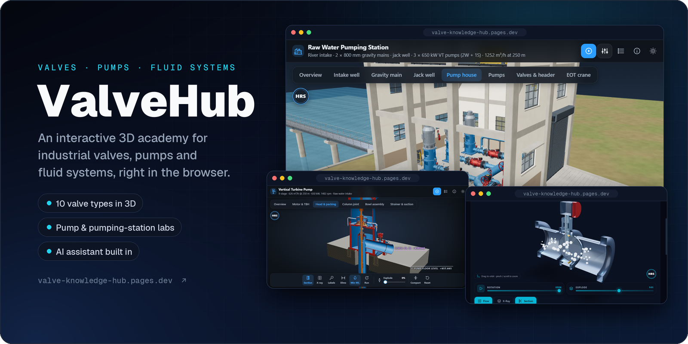
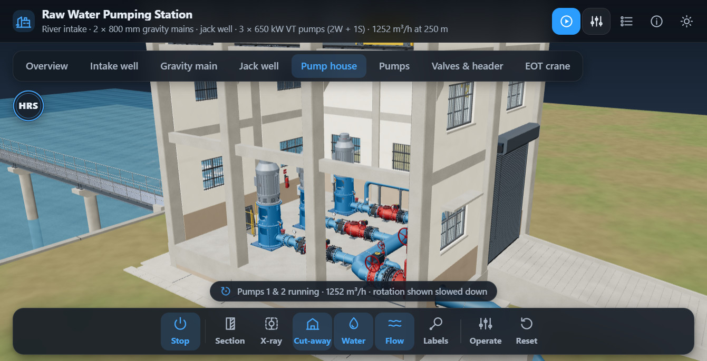
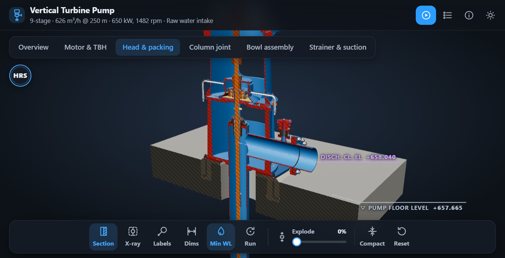
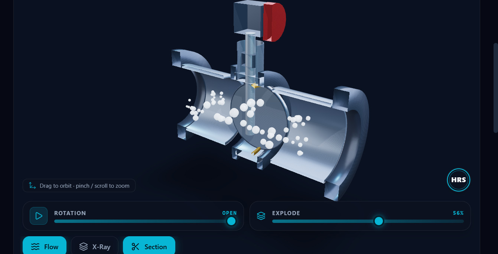

<div align="center">



# ValveHub

**An interactive 3D academy for industrial valves, pumps and fluid systems.**<br />
Open up real equipment in your browser. Cut it away, explode it, run it and see how it works.

[**Live site**](https://valve-knowledge-hub.pages.dev) &nbsp;·&nbsp; [Docs](docs/) &nbsp;·&nbsp; [Roadmap](docs/DEVELOPMENT_ROADMAP.md)


</div>

## ✨ What's inside

- 🔩 &nbsp;**3D Explorer:** 10 valve types (wedge gate, globe, floating ball, triple-offset butterfly, swing check, diaphragm, lubricated plug, needle, spring-loaded safety and air release). Use section cut, X-ray, explode and flow particles, and tap any part to learn its role and materials.
- 🏭 &nbsp;**Equipment Lab:** a 9-stage vertical turbine pump with a guided tour, section cut, X-ray, exploded view and water levels. There's also a raw water pumping station you can operate, and the whole intake site as a walkable 3D world, by day or night.
- 📚 &nbsp;**Academy:** four modules covering valve mechanics, fluid dynamics and Cv/Kv, sizing and selection, and diagnostics and standards, plus a valve animation sandbox.
- 🧮 &nbsp;**Tools:** a live flow simulator on the home page and a valve comparison matrix. A Cv/Kv calculator and a chemical compatibility chart are coming soon.
- 🔎 &nbsp;**Knowledge Finder:** search valves by name, component, material, application or standard.
- 🤖 &nbsp;**Ask AI:** a built-in assistant on Cloudflare Workers AI that answers questions about valves, pumps, piping and fluid systems.

## 📸 Screenshots

<table>
  <tr>
    <td width="50%"></td>
    <td width="50%"></td>
  </tr>
  <tr>
    <td align="center"><sub><b>Pumping station:</b> pump house cut-away, pumps running</sub></td>
    <td align="center"><sub><b>Vertical turbine pump:</b> section through the discharge head</sub></td>
  </tr>
  <tr>
    <td colspan="2"></td>
  </tr>
  <tr>
    <td colspan="2" align="center"><sub><b>3D Explorer:</b> triple-offset butterfly valve, sectioned and exploded, with flow on</sub></td>
  </tr>
</table>

## 🧱 Tech stack

| Layer | Tools |
| :-- | :-- |
| Framework | Next.js 16 (App Router, static export), React 19, TypeScript |
| 3D | Three.js, React Three Fiber, Drei |
| UI & motion | Tailwind CSS 4, Framer Motion, Lucide icons |
| Hosting | Cloudflare Pages, serving the static `out/` folder |
| AI assistant | Cloudflare Pages Function (`functions/api/chat.js`) with Workers AI |

## 🚀 Getting started

```bash
git clone https://github.com/harsh-hrs/valve-knowledge-hub.git
cd valve-knowledge-hub
npm install
npm run dev
```

Then open [http://localhost:3000](http://localhost:3000).

```bash
npm run build   # static export to ./out
npm run lint
```

### Deploying to Cloudflare Pages

- **Build command:** `npm run build`
- **Output directory:** `out`
- **AI assistant:** `functions/api/chat.js` runs as a Pages Function. Add a **Workers AI** binding named `AI` in the Pages project settings to turn it on. It runs on Cloudflare, not under `npm run dev`.

## 🗂️ Project structure

```text
src/
├─ app/                 # routes: explore, equipment, learn, tools, search…
├─ components/
│  ├─ 3d/               # ModelViewer, ValveModels and the creator mark
│  ├─ chat/             # Ask AI widget
│  ├─ equipment/        # embeds the Equipment Lab scenes
│  └─ layout/           # Navbar and Footer
└─ lib/                 # valve, category, academy and equipment data
public/viewers/         # standalone 3D scenes: pump, pumping station, intake site
functions/api/chat.js   # Cloudflare Pages Function for the AI assistant
docs/                   # vision, roadmap, design system and modelling standards
```

## 📖 Docs

- [Project vision](docs/PROJECT_VISION.md) and [development roadmap](docs/DEVELOPMENT_ROADMAP.md)
- [UI design system](docs/UI_DESIGN_SYSTEM.md), [3D model standards](docs/3D_MODEL_STANDARDS.md) and [animation standards](docs/ANIMATION_STANDARDS.md)
- [Content guidelines](docs/CONTENT_GUIDELINES.md) and [project rules](docs/PROJECT_RULES.md)
- [Valve hierarchy](docs/VALVE_HIERARCHY.md) and [valve taxonomy (JSON)](docs/VALVE_TAXONOMY.json)

## 👤 Author

Created by **Harsh Raj Singh** ([@harsh-hrs](https://github.com/harsh-hrs)).
